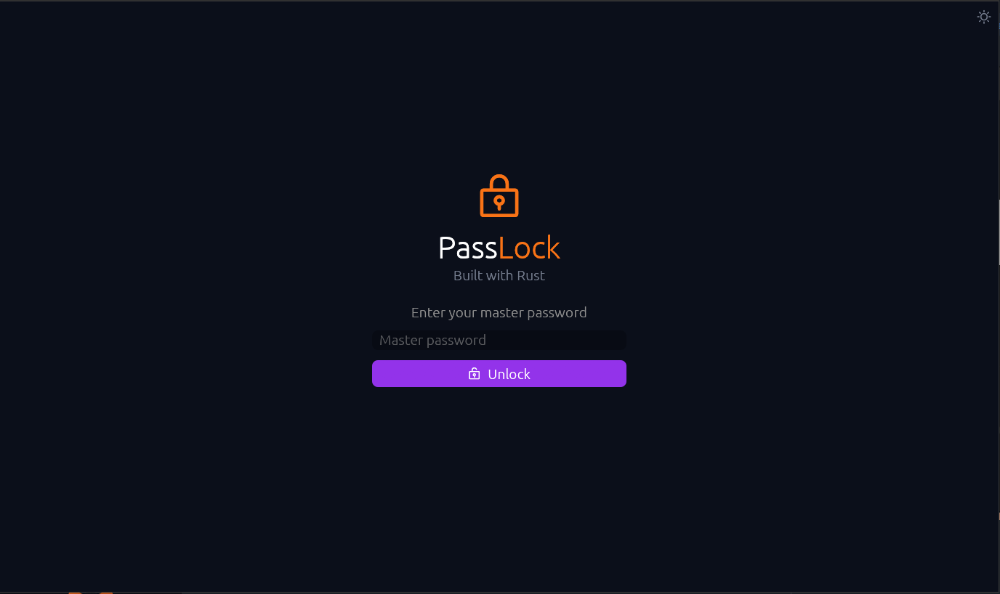
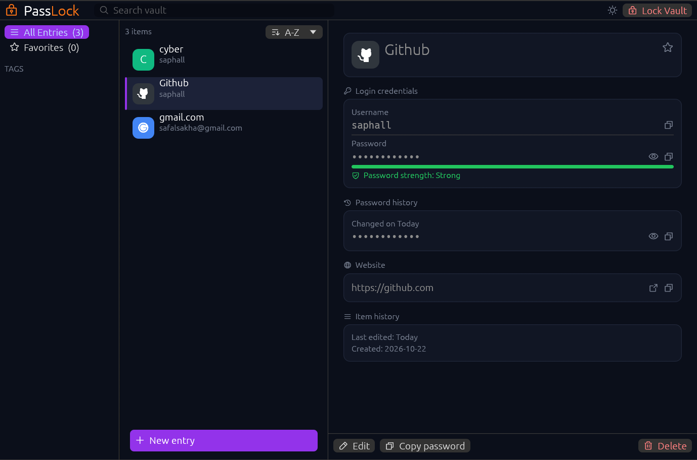

# passlock 🔒

<p>

</p>

An encrypted local password manager with a master password, written in Rust with a native desktop GUI ([egui](https://github.com/emilk/egui)).
Your passwords never leave your machine.

## Project structure

```
passlock/
├── Cargo.toml
├── Cargo.lock
├── LICENSE
├── README.md
├── assets/
│   ├── logo.png
│   └── fonts/        Phosphor icon fonts (MIT)
├── .github/workflows/release.yml   build and publish binaries when the version changes
├── src/
│   ├── main.rs       window setup
│   ├── lib.rs        exposes crypto, models, storage to tests
│   ├── app.rs        egui interface
│   ├── icons.rs      icon font setup and glyphs
│   ├── crypto.rs     Argon2id + XChaCha20-Poly1305
│   ├── storage.rs    encrypted vault file
│   └── models.rs     entries, strength, password generator
└── tests/
    ├── crypto_tests.rs
    └── storage_tests.rs
```

## Features

- Master password protects a single encrypted vault file
- Add, edit, delete, search and sort entries (name, URL, username, password, tags)
- Favorites and tag filters
- Password generator and strength indicator
- Password history (last 5 passwords per entry)
- Copy to clipboard, cleared automatically after 30 seconds
- Light and dark theme (toggle in the header, remembered between launches)
- Site logos for well-known services, generated offline

## Run

> Prerequisite: [Rust](https://doc.rust-lang.org/book/ch01-01-installation.html)

```bash
cargo run --release
```

On first launch, choose a master password (at least 8 characters). The vault is created and unlocked.
On later launches, enter the same password to unlock.

> The master password cannot be recovered. If you forget it, the vault cannot be decrypted.

### Test

```bash
cargo test
```

## Download

Pre-built binaries for Linux, Windows and macOS (Intel and Apple Silicon) are attached to each
[GitHub release](../../releases). Download the archive for your system, extract it and run `passlock`.
Verify the download against `SHA256SUMS.txt` from the same release.

## Screenshots

<p>


</p>

### Release

Pushing to `main` publishes a release automatically when the `version` in `Cargo.toml` has no release yet.
Pushing a `v<version>` tag that matches `Cargo.toml` does the same.
The workflow ([release.yml](.github/workflows/release.yml)) creates the `v<version>` tag if needed, tests, builds and attaches the binaries.
To ship a new version, bump `version` in `Cargo.toml` (and commit `Cargo.lock`) and push to `main`.
If the tag already exists on another commit, the run fails: bump the version instead of reusing it.

## Security

1. `Argon2id` (64 MiB memory, 3 passes) derives a 256-bit key from the master password and a random 16-byte salt.
2. `XChaCha20-Poly1305` encrypts the vault. Every save uses a fresh random 24-byte nonce, and the authentication tag detects tampering.
3. Only the version, salt, nonce and ciphertext are written to disk. The master password and key are never stored.
4. The vault file is written atomically (temp file, then rename) with `0600` permissions on Unix.
5. The key and the decrypted vault bytes are zeroized when dropped, and the master password field is wiped after unlock.

Not covered: malware or keyloggers on your machine, and other apps reading the clipboard during the 30 second window.

### Vault location

| OS      | Path                                                    |
| ------- | ------------------------------------------------------- |
| Linux   | `~/.local/share/passlock/vault.passlock`                |
| macOS   | `~/Library/Application Support/passlock/vault.passlock` |
| Windows | `%APPDATA%\passlock\vault.passlock`                     |

To back up your vault, copy this file. To restore it, put it back in the same place.

## Built with

[eframe / egui](https://github.com/emilk/egui) | [argon2](https://crates.io/crates/argon2) | [chacha20poly1305](https://crates.io/crates/chacha20poly1305) | [rand](https://crates.io/crates/rand) | [serde](https://serde.rs) | [zeroize](https://crates.io/crates/zeroize) | [Phosphor Icons](https://phosphoricons.com)

## License

Released under the [GNU General Public License v3.0](LICENSE). The bundled Phosphor icon fonts are MIT licensed (see [assets/fonts/LICENSE-MIT](assets/fonts/LICENSE-MIT)).
